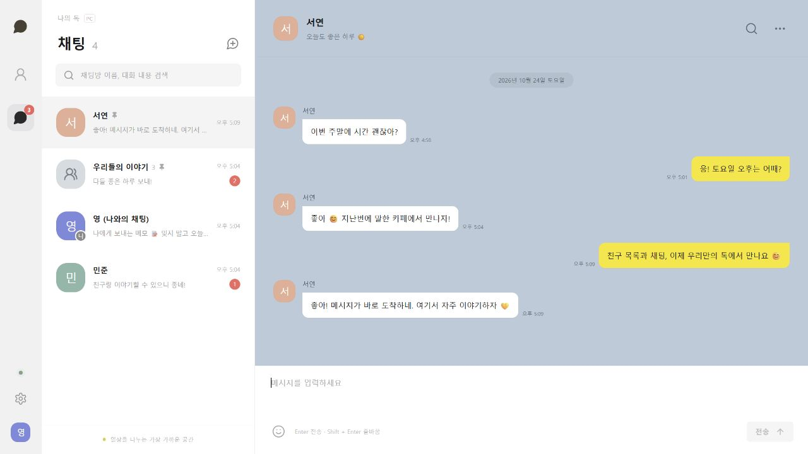

# 나의 톡

설치된 KakaoTalk PC `26.9.0.5337`의 친구·채팅 리소스를 조사하고 만든 독립 데스크톱 메신저입니다. 친구 관리와 텍스트 채팅에 집중한 첫 실행 버전입니다.

친구 ID 검색·추가, 표시 이름 변경, 즐겨찾기, 숨김·복구, 차단·해제를 지원합니다. 1:1·그룹·나와의 채팅에서 실제 실시간 메시지, 읽음 수, 입력 중 표시, 대화 검색, 이전 대화, 방 고정·알림 설정을 사용할 수 있습니다. 계정과 대화는 SQLite에 보존됩니다.



## 실행

Node.js 22.13 이상이 필요합니다. 프로젝트 폴더에서 실행하세요.

```powershell
npm install
npm run desktop
```

Electron 창과 자체 로컬 서버가 함께 실행됩니다. 로그인을 다시 하더라도 저장된 친구와 대화는 유지됩니다. 설치 프로그램 `.exe` 패키징은 후속 작업입니다.

브라우저 개발 및 두 계정 테스트:

```powershell
npm run dev
```

[개발 화면](http://127.0.0.1:5173)을 서로 다른 두 탭에서 열고 각각 다른 계정으로 로그인하면 실시간 대화를 확인할 수 있습니다. 로그인은 탭별로 독립적입니다. `npm run build` 후 `npm start`로 [빌드된 화면](http://127.0.0.1:4100)을 열 수도 있습니다.

| 데모 아이디 | 비밀번호 |
| --- | --- |
| `young` | `12345678` |
| `seoyeon` | `12345678` |
| `minjun` | `12345678` |

자신만의 계정을 새로 만들 수도 있습니다. 데모는 빈 DB에서만 초기화하며 자동 응답 봇은 없습니다. 친구는 같은 서버에 가입한 사용자끼리 추가합니다.

## 저장과 검증

- 웹 개발 DB: `data/talk.sqlite`
- Electron DB: Electron 사용자 데이터 폴더의 `kakaotalk.sqlite` (웹 개발 DB와 별도)
- 로그인: 탭별 `sessionStorage`; 창을 닫으면 다시 로그인
- 테스트: `npm test` — 실제 HTTP/WebSocket을 포함한 통합 테스트 13개 통과
- 빌드: `npm run build` 통과
- 브라우저: 두 계정 양방향 전송·읽음, 친구 추가·이름·즐겨찾기·숨김·차단·복구, 검색, 고정·알림 조작 확인
- 데스크톱: 실제 Electron 창 생성 및 내장 Node/SQLite 실행 확인. 네이티브 창 내부 조작·재시작 검증은 후속 기록 참조

현재 서버는 이 PC의 loopback 주소로만 실행합니다. 카카오톡 계정·친구·대화 가져오기와 카카오 서버 연결은 구현하지 않았습니다. 첨부파일, 답장, 전화번호 친구 추가 등은 다음 단계입니다.

## 조사와 이어서 개발

[진행 기록](docs/PROGRESS.md)에 완료 기능, 검증 범위, 다음 우선순위와 다음 대화용 요청문이 있습니다. [원본 조사](docs/research/README.md)에는 실제 REA Evidence와 설치 문자열의 출처·해시·한계가 있습니다. [API 문서](server/README.md)는 서버 계약을 설명합니다.

원본의 문자열·색상·폰트와 PE 리소스를 정적으로 확인했습니다. 네이티브 함수, 비공개 통신 프로토콜과 정확한 레이아웃 치수는 복구하지 않았습니다. 화면의 분할 배치와 일부 동작은 이 앱의 설계 선택이며, 원본의 이미지 자산이나 개인 대화 DB를 복사하지 않았습니다.
