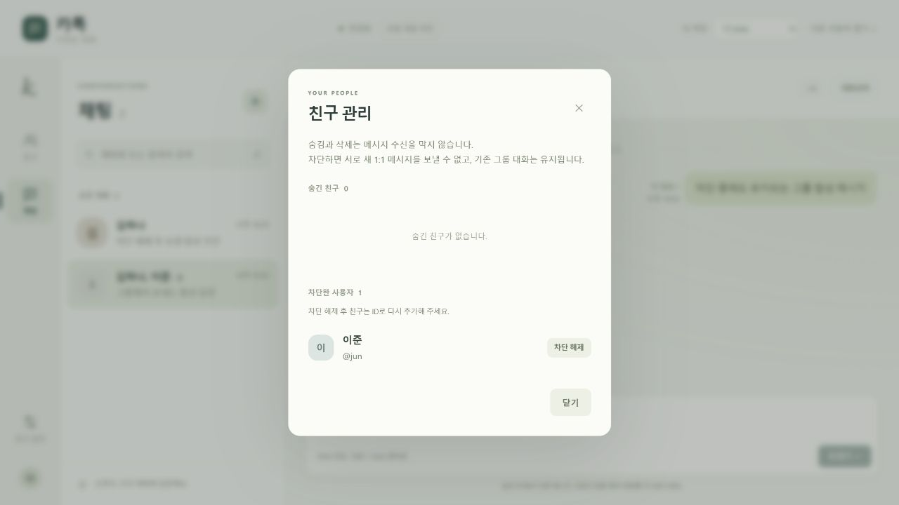

# 친구 차단·해제 검증 — 2026-10-23 (Asia/Seoul)

## 기존 근거 → 자체 정책

기존 [OBS-R07](../research/installed-resource-flows.md)의 차단 안내와 [OBS-UI05](../research/runtime-ui-observations.md)의 차단 메뉴 관찰을 재사용했다. `IDS_CONTACT_100019`, `IDS_FRIENDMNGRLSTCTRL_100015`, `IDS_ADDFRIENDDLG_100032`의 해제 후 재추가 안내는 상충하며 원본 정책을 확정하지 않았다. 새로운 원본 조사나 관계 변경을 수행하지 않았고, REA Evidence·OBS-R·OBS-UI를 추가하지 않았다.

[ARCHITECTURE.md](../ARCHITECTURE.md)의 자체 정책에 따라 차단 관계를 친구 표시와 분리했다. 내 방향 친구 관계를 제거하고, 어느 방향이든 차단이 있으면 새 1:1 송신과 1:1 생성/재사용을 거부한다. 기존 내역·읽음·그룹 송수신은 유지하고, 해제만으로 친구를 복구하지 않는다. 차단 전 이미 저장된 메시지의 동일 clientId 재시도는 성공 응답을 돌려준다. 신규 그룹에는 생성자가 차단한 사용자를 넣을 수 없다.

구현 파일: `server/store.mjs`, `server/index.mjs`, `public/app.js`, `public/index.html`, `public/styles.css`. 자동 검증: `test/friend-blocking.test.mjs`.

## 검증 환경과 보존

- Node.js 22.23.2, Windows, 합성 me/hana/jun/sora 계정만 사용했다.
- API/도메인 검증은 `test-results/katok-block-*` 등의 임시 저장소를 사용한다.
- 브라우저 검증은 `PORT=4174`, `KATOK_DATA_FILE=test-results/ui-block-session-03.json`을 지정한 `npm start`로 수행했다. me 2창과 hana 1창을 사용했다.
- 기존 `data/messenger.json`의 전후 SHA-256은 `2E2EBF60137515D4E3E1A3D5DB2AED1D3EFE33AF71CDAE629DA7C6EC6B06D95A`로 동일하다. 기존 작업 데이터는 수정하지 않았다.
- 검증 서버는 종료했다. 합성 UI 저장소는 Git 제외이며 아래 스크린샷에도 원본 계정·친구·대화·자산을 사용하지 않았다.

## 자동 검증

`npm test`: **27 tests passed, 0 failed, 0 skipped**. 기존 16개와 신규 차단 검증 11개가 통과했다.

| 범위 | 확인 결과 |
| --- | --- |
| 방향성·숨김·보존 | 숨긴 친구도 내 관계만 제거. 반대 관계·사용자·방·메시지·읽음 커서 보존, 재개방 후 동일 |
| API 입력·비친구 | 자기 자신/빈 값/잘못된 타입/URI는 400, 미존재는 404. 비친구 차단 가능, 차단 중 친구 추가 409·숨김 복귀 404, 친구 DELETE로 해제 불가 |
| 1:1 경계 | 양쪽 새 송신·방 생성/재사용 403. 거부 시 파일/순번 불변. 기존 동일 clientId 재시도 성공, 다른 본문 409. 기존 내역 읽기·읽음 처리 유지 |
| 상호 차단·해제 | 자기 방향만 해제, 반대 차단 잔존 시 제한 지속. 자동 재추가 없음. 양쪽 해제 후 송신/기존 방 재사용 가능 |
| 그룹 | 기존 그룹의 양방향 송수신·안 읽음 분모·커서 유지. 생성자의 차단 대상 포함 신규 그룹은 403, 다른 참여자의 차단 관계는 그룹 생성을 막지 않음 |
| 멱등성과 저장 | 동시 반복 차단/해제 중 실제 저장·알림은 각 한 번. 이미 원하는 상태면 저장 불가 환경에서도 성공 |
| 구형 파일·손상 보호 | blocks 없는 version 1 파일은 열기/무변경 요청으로 재작성하지 않음. 다음 저장에 blocks 추가. 잘못된 배열·중복·자기 자신·미존재·친구와 동일 방향 중첩은 시작 거부 및 원본 보존 |
| 실패 복구 | 차단/해제 저장 실패 시 두 사용자의 메모리·파일 유지, 알림 없음, 임시파일 정리. 실패 제거 후 같은 큐에서 재시도 성공 |
| SSE·직렬화 | 양 사용자 SSE를 받은 시점에 파일 저장 완료. 송신→차단→송신 큐에서 앞 메시지만 저장하고 뒤 메시지 거부, 해제 후 순번 연속 |

기본 sandbox에서는 13개가 통과하고 HTTP 검증 14개가 localhost `fetch failed`로 실패했다. 승인된 실행 환경에서 전체 27개가 통과했다. 이는 기존 세션에서 확인한 연결 제약이며 제품 코드의 우회로 처리하지 않았다.

`node --check`(서버 2개, 프런트, 신규 테스트) 및 `git diff --check` 통과. LF→CRLF 안내는 공백 오류가 아니다.

## 실제 브라우저 검증

| 조작 | 확인 결과 |
| --- | --- |
| 일반 친구 프로필 → 차단 | 이름/ID와 1:1·그룹·기존 내역·해제 후 재추가 정책 표시, 기본 초점 취소 |
| 취소 및 다시 열어 Escape | 관계 요청 없이 프로필·친구 유지 |
| me 다른 창 새 채팅에서 hana 선택, hana 창에 1:1 초안 작성 후 me 차단 | me 친구 수 2→1·프로필 닫힘. 다른 me 창 선택 1→0·생성 비활성·검색창 초점. hana 입력 읽기 전용·전송 비활성·정책 안내, 초안 보존 |
| 차단 중 기존 그룹에서 me 송신, hana 수신·답장 | 양쪽 메시지 정상 표시. 기존 1:1로 돌아오면 초안과 전송 제한 유지 |
| 새로고침 → 친구 관리 | 차단 목록 지속. hana ID 추가 시 해제 안내와 추가 거부 |
| 친구 관리 → 해제 확정 | 차단 목록 1→0, 친구 자동 추가 없음. 상대 창 입력·전송 활성, 보존한 초안 전송 성공 |
| 비친구 상태의 기존 1:1 → 대화상대 → 차단·해제 | 대상 버튼이 차단↔해제로 갱신, 기존 대화 내역 보존 |
| ID hana 재추가 → 대화 시작 | 기존 1:1 방과 해제 후 수신한 메시지 유지, 중복 방 없음 |
| jun 숨김 → 친구 관리 → 차단 확인창 | 숨긴 목록에서 차단 진입, 이름·ID 정확히 표시 |
| 확인창을 연 상태에서 검증 서버 종료 → 차단 제출 | 한국어 연결 오류, 대상/확인창/취소·재시도 유지, 차단 버튼에 초점 |
| 동일 저장소로 서버 복구 → 열린 확인창에서 재시도 | 성공, 숨긴 목록 1→0·차단 목록 0→1. 다른 me 창에도 동일 반영, 닫기 버튼 초점 |
| 1280px 및 약 570px 폭 화면 시각 확인 | 관리 모달, 차단 행, 해제·닫기 버튼 잘림 없이 표시 |

정상 시나리오 후 세 창의 콘솔 error 로그는 모두 0개였다. 의도적인 서버 종료 시 발생한 네트워크 오류는 이 수치와 구분한다.

검토 중 보완한 내용: 차단·삭제 성공 ACK 전에 시작된 오래된 bootstrap 응답이 확정 상태를 덮지 않도록 관계 변경 revision을 검사한다. 해제 직후에는 반대 방향 차단 여부를 확인할 때까지 보수적으로 기존 송신 제한을 유지한다. 삭제/숨김 안내도 해당 동작 자체가 수신을 막지 않는다는 문장으로 바꿨다.

## 한계와 후속 확인

원본 카카오톡의 차단/해제·그룹·프로필 비공개 정책을 검증한 결과가 아니다. 프로필 비공개는 구현하지 않았다. 현재 `canSend`와 전송 거부로 상대가 1:1 제한 상태를 추론할 수 있으며 실제 인증도 없다.

응답 유실 뒤 반대 연산과 재시도가 교차하는 경우 요청 세대 식별자가 없어 나중에 서버에서 처리한 의도가 적용된다. 저장된 clientId 재시도와 큐 경계는 자동 검증했고, 오래된 bootstrap 지연·ACK 유실의 브라우저 네트워크 주입 검증은 수행하지 않았다. 모달 제출 중 중복·Escape 방지 및 revision 보호는 코드 검토로 확인했다. 좁은 화면은 현재 패널 폭에서 확인했으며 320px 전체 흐름·전체 키보드 탐색은 별도 검증 대상이다.
